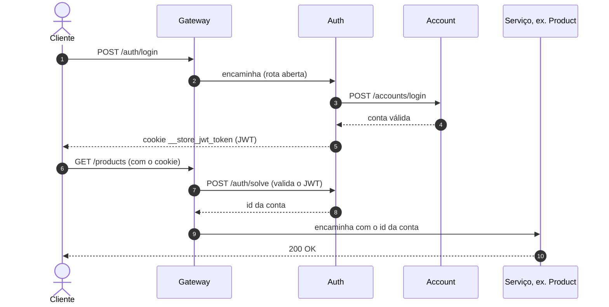
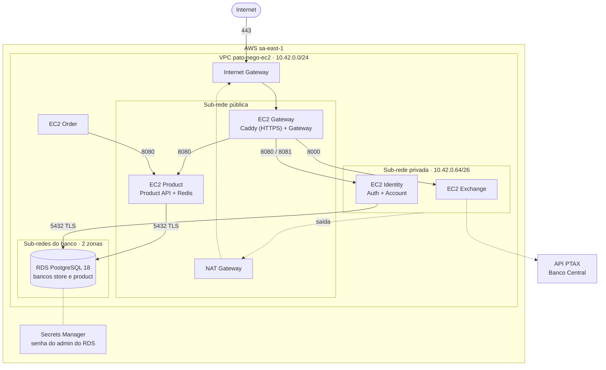
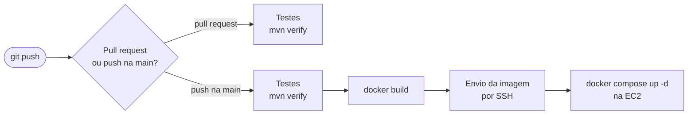

# 🦆 pato-nego

Loja online construída com **microsserviços**, onde usuários compram e vendem produtos. Projeto da disciplina de Microsserviços do **Insper** (2026.2).

Cada serviço vive no seu próprio repositório e roda na **AWS (São Paulo, `sa-east-1`)**. O repositório principal, [`nego-pato`](https://github.com/pato-nego/nego-pato), reúne todos eles como submódulos e guarda a infraestrutura de deploy.

---

## Arquitetura

Toda requisição externa entra por um **único ponto**, o gateway. Os demais serviços ficam numa camada confiável, sem acesso direto pela internet.


### Autenticação

O gateway valida o login em toda rota protegida. Só três rotas são abertas: `POST /auth/register`, `POST /auth/login` e `GET /auth/logout`.



---

## Serviços e repositórios

A organização segue um padrão: o repositório **`X`** é uma biblioteca com a interface Feign e os DTOs (para outros serviços chamarem `X`), e o **`X-service`** é a implementação.

| Serviço | Responsabilidade | Interface | Implementação | Tecnologia |
|---|---|---|---|---|
| **Gateway** | ponto único de entrada, roteamento e validação do login | — | [Gateway-service](https://github.com/pato-nego/Gateway-service) | Java, Spring Cloud Gateway |
| **Auth** | cadastro, login e emissão/validação de JWT | [Auth](https://github.com/pato-nego/Auth) | [Auth-service](https://github.com/pato-nego/Auth-service) | Java, Spring Boot |
| **Account** | dados das contas de usuário | [Account](https://github.com/pato-nego/Account) | [Account-service](https://github.com/pato-nego/Account-service) | Java, Spring Boot, JPA |
| **Exchange** | cotação de moedas pela PTAX do Banco Central | [Exchange](https://github.com/pato-nego/Exchange) | [Exchange-service](https://github.com/pato-nego/Exchange-service) | Python, FastAPI |
| **Product** | catálogo de produtos, com cache Redis | — | [Product](https://github.com/pato-nego/Product) | Java, Spring Boot, JPA, Redis |
| **Order** | pedidos, com preço do Product e câmbio do Exchange | [Order](https://github.com/pato-nego/Order) | [Order-service](https://github.com/pato-nego/Order-service) | Java, Spring Boot, OpenFeign, Flyway |
| — | submódulos, Compose local e deploy na AWS | — | [nego-pato](https://github.com/pato-nego/nego-pato) | CloudFormation, Docker Compose, Caddy |

O Product não tem repositório de interface porque o único serviço que o consome, o Order, já tem o próprio cliente (`ProductClient`).

### Rotas principais

| Serviço | Rotas |
|---|---|
| Auth | `POST /auth/register` · `POST /auth/login` · `GET /auth/me` · `GET /auth/logout` |
| Account | `POST /accounts` · `GET /accounts` · `GET /accounts/{id}` · `DELETE /accounts/{id}` |
| Exchange | `GET /exchange/{from}/{to}` |
| Product | `POST /products` · `GET /products` · `GET /products/{id}` · `DELETE /products/{id}` |
| Order | `POST /orders` · `GET /orders` · `GET /orders/{id}` |

Gateway, Auth, Account e Order expõem `GET /<serviço>/health-check`, que responde `200` quando o serviço está de pé. As rotas do Order ainda não estão cadastradas no gateway.

---

## Infraestrutura na AWS

A infraestrutura dos serviços privados e do banco é descrita como código no template CloudFormation [`stack.yaml`](https://github.com/pato-nego/nego-pato/blob/main/deploy/ec2/stack.yaml) (stack `pato-nego-private-services`).



### Componentes

| Recurso | Configuração | Papel |
|---|---|---|
| **EC2 Gateway** | Caddy com certificado Let's Encrypt + Spring Cloud Gateway | única máquina que recebe tráfego da internet (80/443) |
| **EC2 Identity** | t3.small, sub-rede privada | Auth (8080) e Account (8081) |
| **EC2 Exchange** | t3.micro, sub-rede privada | API de câmbio (8000) |
| **EC2 Product** | t3.micro, Amazon Linux 2023 | Product API (8080) e Redis em container |
| **EC2 Order** | t3.micro | Order API |
| **RDS PostgreSQL** | 18.6, `db.t4g.micro`, 20 GB gp3 criptografado, backup de 7 dias | um banco por serviço: `store` (Account) e `product` |
| **NAT Gateway** | Elastic IP na sub-rede pública | permite que as máquinas privadas baixem pacotes e imagens sem ficarem expostas |
| **Secrets Manager** | senha gerenciada e rotacionada pelo RDS | credencial de administrador do banco |

### Segurança

- **Ponto único de entrada:** só o gateway tem as portas 80/443 abertas para a internet.
- **Firewall por serviço:** cada serviço tem um security group próprio que aceita conexões apenas do gateway (e o Product também do Order).
- **Banco privado:** o RDS não é acessível publicamente e só aceita a porta 5432 vinda do Identity e do Product.
- **Menor privilégio no banco:** cada serviço tem o próprio usuário (`account_app`, `product_app`) e só acessa o próprio banco.
- **TLS até o banco:** as conexões usam `sslmode=verify-full`, validando o certificado do RDS.
- **SSH:** apenas por chave. As máquinas privadas são acessadas usando o gateway como *jump host*.
- **Segredos fora do Git:** senhas e chaves ficam em arquivos `.env` nas máquinas ou nos segredos do GitHub Actions.

---

## CI/CD



| Repositório | Ferramenta | O que faz |
|---|---|---|
| Product | GitHub Actions | testes em todo PR; testes, build e deploy na EC2 a cada push na `main` |
| Order-service | GitHub Actions | testes, build, deploy na EC2 e verificação do health-check |
| Account-service | Jenkins | pipeline de build |

---

## Rodando localmente

O `nego-pato` sobe a stack inteira com Docker Compose:

```bash
git clone --recurse-submodules https://github.com/pato-nego/nego-pato.git
cd nego-pato
export JWT_SECRET_KEY="$(openssl rand -base64 32)"
docker compose -f api/compose.yaml up --build
```

As instruções completas (build dos serviços Java e testes com cookie de login) estão no [README do nego-pato](https://github.com/pato-nego/nego-pato#readme). O deploy na AWS está descrito no [guia de deploy em EC2](https://github.com/pato-nego/nego-pato/blob/main/deploy/ec2/README.md).

---

## Tecnologias

**Backend:** Java 25 · Spring Boot · Spring Cloud Gateway · Spring Data JPA · OpenFeign · Flyway · Python · FastAPI
**Dados:** PostgreSQL (AWS RDS) · Redis
**Infraestrutura:** AWS EC2 · RDS · VPC · NAT Gateway · Secrets Manager · CloudFormation · Docker · Docker Compose · Caddy
**CI/CD:** GitHub Actions · Jenkins
