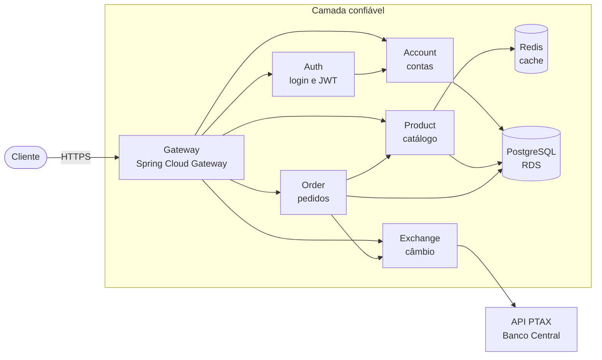
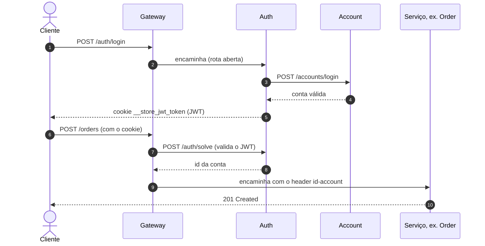
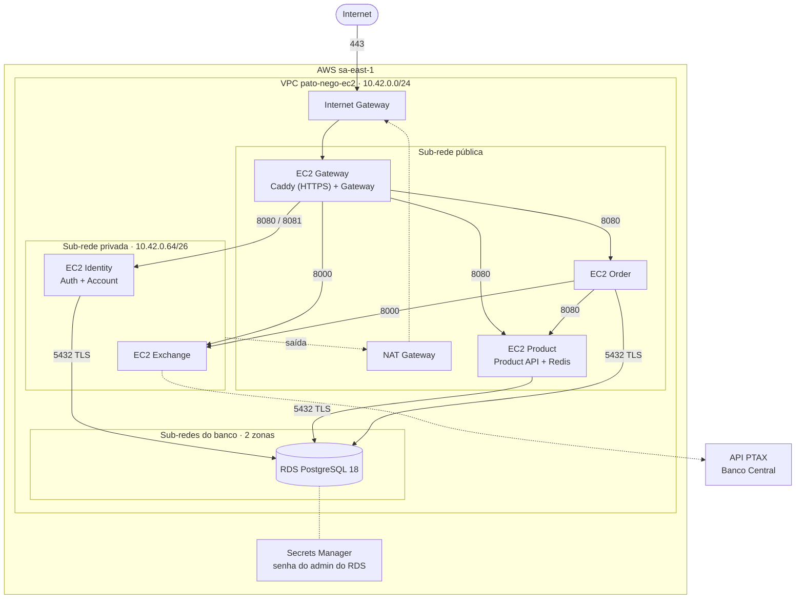
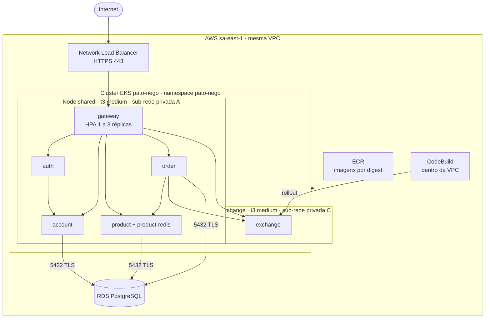
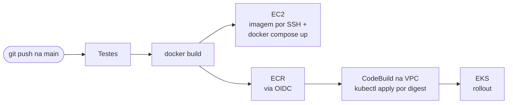

# 🦆 pato-nego

Loja online construída com **microsserviços**: o usuário se cadastra, entra com login e faz pedidos de produtos com preço em dólar, podendo ver o total em reais pela cotação PTAX do Banco Central. Projeto da disciplina de Microsserviços do **Insper** (2026.2).

Cada serviço vive no seu próprio repositório e roda na **AWS (São Paulo, `sa-east-1`)**, em dois ambientes: máquinas **EC2** e um cluster **Kubernetes (EKS)**. O repositório principal, [`nego-pato`](https://github.com/pato-nego/nego-pato), reúne todos eles como submódulos e guarda a infraestrutura do cluster.

📖 **Documentação completa:** [pato-nego.github.io/nego-pato](https://pato-nego.github.io/nego-pato/), com a demonstração da compra, Kubernetes, testes de carga e custos.

---

## Arquitetura

Toda requisição externa entra por um **único ponto**, o gateway. Os demais serviços ficam numa camada confiável, sem acesso direto pela internet.



### Autenticação

O gateway valida o login em toda rota protegida. As rotas abertas são `POST /auth/register`, `POST /auth/login`, `GET /auth/logout` e o health-check do gateway e do Exchange. Depois de validar o cookie, o gateway repassa o usuário no header `id-account`, que o Order e o Exchange usam para saber quem fez a requisição.



### Fluxo de uma compra

1. O comprador cria um pedido com `POST /orders`, informando os produtos e as quantidades.
2. O Order consulta o preço de cada item no Product e congela o valor em dólar.
3. Em `GET /orders/{id}?currency=BRL`, o Order pede a cotação ao Exchange, que busca a PTAX de venda no Banco Central. O preço guardado continua em dólar.
4. Cada pedido pertence a quem o criou: outro usuário recebe `404`.

---

## Serviços e repositórios

A organização segue um padrão: o repositório **`X`** é uma biblioteca com a interface Feign e os DTOs (o contrato), e o **`X-service`** é a implementação.

| Serviço | Responsabilidade | Contrato | Implementação | Tecnologia |
|---|---|---|---|---|
| **Gateway** | ponto único de entrada, roteamento e validação do login | — | [Gateway-service](https://github.com/pato-nego/Gateway-service) | Java, Spring Cloud Gateway |
| **Auth** | cadastro, login e emissão/validação de JWT | [Auth](https://github.com/pato-nego/Auth) | [Auth-service](https://github.com/pato-nego/Auth-service) | Java, Spring Boot |
| **Account** | contas e senhas com hash, no PostgreSQL | [Account](https://github.com/pato-nego/Account) | [Account-service](https://github.com/pato-nego/Account-service) | Java, Spring Boot, JPA, Flyway |
| **Exchange** | cotação de moedas pela PTAX do Banco Central, com cache | — | [Exchange](https://github.com/pato-nego/Exchange) | Python, FastAPI |
| **Product** | catálogo de produtos, com cache Redis | — | [Product](https://github.com/pato-nego/Product) | Java, Spring Boot, JPA, Redis |
| **Order** | pedidos, com preço do Product e câmbio do Exchange | [Order](https://github.com/pato-nego/Order) | [Order-service](https://github.com/pato-nego/Order-service) | Java, Spring Boot, OpenFeign, Flyway |
| — | submódulos, Compose local, infraestrutura do EKS e documentação | — | [nego-pato](https://github.com/pato-nego/nego-pato) | CloudFormation, Docker Compose, MkDocs |

Exceções ao padrão:

- **Exchange:** como é em Python, não tem contrato Feign. O repositório `Exchange` contém a API completa que vai para produção. O [Exchange-service](https://github.com/pato-nego/Exchange-service) guarda a lógica original de consulta à PTAX, com os próprios testes.
- **Product:** não tem repositório de contrato porque o único serviço que o consome, o Order, já tem o próprio cliente (`ProductClient`).

### Rotas principais

| Serviço | Rotas | Health-check |
|---|---|---|
| Gateway | — | `GET /health-check` |
| Auth | `POST /auth/register` · `POST /auth/login` · `GET /auth/me` · `GET /auth/logout` | `GET /auth/health-check` |
| Account | `POST /accounts` · `GET /accounts` · `GET /accounts/{id}` · `DELETE /accounts/{id}` | `GET /accounts/health-check` |
| Exchange | `GET /exchange/{from}/{to}` · `GET /exchange/currencies` | `GET /exchange/health-check` |
| Product | `POST /products` · `GET /products` · `GET /products/{id}` · `DELETE /products/{id}` | `GET /products/health-check` |
| Order | `POST /orders` · `GET /orders` · `GET /orders/{id}` · `GET /orders/{id}?currency=BRL` | `GET /orders/health-check` |

Os health-checks respondem `200` quando o serviço está de pé, sem expor nenhuma informação interna. No Kubernetes, eles são usados pelas *probes* de startup, readiness e liveness.

---

## Infraestrutura na AWS

Os dois ambientes compartilham a mesma VPC, o NAT Gateway e a instância RDS. Cada um tem o próprio gateway e os próprios bancos.

### Ambiente EC2

Uma máquina por serviço, com Docker Compose. A rede e o banco foram criados com o template CloudFormation [`stack.yaml`](https://github.com/pato-nego/nego-pato/blob/0e7077915d5e313d25e1a688e07a7041d9077150/deploy/ec2/stack.yaml) (stack `pato-nego-private-services`).



| Recurso | Configuração | Papel |
|---|---|---|
| **EC2 Gateway** | t3.medium, Caddy com certificado Let's Encrypt + Spring Cloud Gateway | única máquina que recebe tráfego da internet (80/443) |
| **EC2 Identity** | t3.small, sub-rede privada | Auth (8080) e Account (8081) |
| **EC2 Exchange** | t3.micro, sub-rede privada | API de câmbio (8000) |
| **EC2 Product** | t3.micro, Amazon Linux 2023 | Product API (8080) e Redis em container |
| **EC2 Order** | t3.micro, Amazon Linux 2023 | Order API (8080) |
| **RDS PostgreSQL** | 18.6, `db.t4g.micro`, 20 GB gp3 criptografado, backup de 7 dias | um banco e um usuário por serviço |
| **NAT Gateway** | Elastic IP na sub-rede pública | saída para a internet das máquinas privadas, sem expô-las |
| **Secrets Manager** | senha gerenciada e rotacionada pelo RDS | credencial de administrador do banco |

### Ambiente Kubernetes (EKS)

Cluster `pato-nego`, namespace `pato-nego`, criado pelo template [`infra/eks.yaml`](https://github.com/pato-nego/nego-pato/blob/main/infra/eks.yaml). Cada serviço tem os próprios manifestos na pasta `k8s/` do repositório.



| Peça | Como funciona |
|---|---|
| **Control plane** | gerenciado pela AWS. A API do Kubernetes aceita conexões só da VPC e do IP do administrador |
| **Nodes** | dois t3.medium em sub-redes privadas de zonas diferentes. O node `exchange` tem label e *taint* próprios e recebe só o Exchange |
| **Entrada** | o gateway termina o TLS atrás de um Network Load Balancer público |
| **Comunicação interna** | pelos nomes dos Services: `auth:8080`, `account:8080`, `product:8080`, `order:8080`, `exchange:8000` |
| **Configuração** | ConfigMaps no Git; Secrets (senhas do banco, chave JWT, certificado TLS) criados direto no namespace, fora do Git |
| **Escala** | HPA no Gateway, Product e Order, de 1 a 3 réplicas com 50% de CPU, usando o metrics-server |
| **Banco** | o RDS fica fora do cluster e só aceita a porta 5432 vinda do security group do cluster |

Gateway, Auth, Account e Exchange foram verificados no cluster. Product e Order já têm os manifestos nos seus repositórios e entram no mesmo namespace.

### Segurança

- **Ponto único de entrada:** em cada ambiente, só o gateway recebe tráfego da internet.
- **Firewall por serviço:** na EC2, cada serviço tem um security group que aceita só o gateway e os serviços que precisam chamá-lo. Por exemplo, o Product aceita o gateway e o Order.
- **Banco privado:** o RDS não é acessível publicamente.
- **Menor privilégio no banco:** cada serviço tem o próprio usuário e só acessa o próprio banco.
- **TLS até o banco:** as conexões usam `sslmode=verify-full`, validando o certificado do RDS.
- **Senhas com hash e salt** no Account.
- **Pods sem credenciais do Kubernetes:** nenhum serviço monta o token da service account (`automountServiceAccountToken: false`).
- **Imagens verificadas:** o CI do Order varre a imagem com o Trivy antes do deploy.
- **Segredos fora do Git:** senhas e chaves ficam em `.env` nas máquinas, nos Secrets do Kubernetes ou nos segredos do GitHub Actions.

---

## CI/CD



| Repositório | Ferramenta | O que faz |
|---|---|---|
| Product | GitHub Actions | testes em todo PR; testes, build e deploy na EC2 a cada push na `main` |
| Order-service | GitHub Actions | testes com o contrato `Order`, build, varredura com Trivy, deploy na EC2 e verificação do health-check |
| Exchange | GitHub Actions + CodeBuild | build, testes dentro da imagem e checagem das respostas HTTP; na `main`, publica no ECR e faz o rollout no EKS pelo digest |
| Exchange-service | GitHub Actions | testes do cliente PTAX |
| Gateway-service | GitHub Actions | build e testes com Maven |
| Account e Account-service | Jenkins | build e publicação da imagem multi-arquitetura no Docker Hub |

---

## Testes de carga e custos

Os detalhes e as evidências estão na [documentação](https://pato-nego.github.io/nego-pato/).

**Desempenho** ([página completa](https://pato-nego.github.io/nego-pato/performance/)), medido com o k6:

| Cenário | Resultado |
|---|---|
| Busca de produto por id, sem cache | p95 médio de 24,68 ms |
| Busca de produto por id, com Redis | p95 médio de 13,91 ms, com 2.724 acertos no cache |
| Criação de pedido, 10 usuários simultâneos | 66 requisições/s, p95 de 58 ms, 0% de erros |
| Gateway no EKS, 180 requisições/s por 2 minutos | o HPA escalou de 1 para 3 réplicas; 21.553 requisições, 0 falhas, p95 de 39 ms |

**Custos** ([página completa](https://pato-nego.github.io/nego-pato/costs/)), em preço de tabela em `sa-east-1`:

| Ambiente | USD/mês |
|---|---:|
| EC2, RDS, NAT e IPs públicos | 235,14 |
| EKS adicional (control plane, 2 nodes, load balancer) | 202,01 |
| Estimativa do AWS Pricing Calculator para os dois juntos | 444,45 |

**Objetivo de serviço proposto:** 99% de leituras autenticadas com sucesso por mês e p95 abaixo de 500 ms para o catálogo em cache, com 10 usuários simultâneos.

---

## Rodando localmente

O `nego-pato` sobe a stack inteira com Docker Compose. É preciso ter JDK 25, Maven e Docker:

```bash
git clone --recurse-submodules https://github.com/pato-nego/nego-pato.git
cd nego-pato
mvn -f api/account/pom.xml install
mvn -f api/auth/pom.xml install
mvn -f api/order/pom.xml install
mvn -f api/account-service/pom.xml package
mvn -f api/auth-service/pom.xml package
mvn -f api/gateway-service/pom.xml package
mvn -f api/order-service/pom.xml package
export JWT_SECRET_KEY="$(openssl rand -base64 32)"
docker compose -f api/compose.yaml up --build
```

O gateway fica em `http://localhost:8080`. Cadastre-se com `POST /auth/register`, entre com `POST /auth/login` e envie o cookie `__store_jwt_token` nas demais rotas. Mais detalhes no [README do nego-pato](https://github.com/pato-nego/nego-pato#readme).

---

## Tecnologias

**Backend:** Java 25 · Spring Boot · Spring Cloud Gateway · Spring Data JPA · OpenFeign · Flyway · Python · FastAPI
**Dados:** PostgreSQL (AWS RDS) · Redis
**Infraestrutura:** AWS EC2 · EKS · ECR · RDS · VPC · NAT Gateway · Network Load Balancer · Secrets Manager · CloudFormation · Docker · Docker Compose · Kubernetes · Caddy
**CI/CD:** GitHub Actions · AWS CodeBuild · Jenkins · Trivy
**Qualidade e documentação:** k6 · MkDocs
